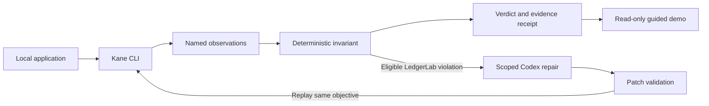

# Invariant

**Correctness beyond tests.**

A browser can complete a transfer while the application creates money. Invariant separates **workflow success** from **business integrity**. Kane CLI performs the workflow and returns named observations. Invariant evaluates a typed contract on those observations. A contained Codex workflow can repair the seeded LedgerLab defect, then rerun the same browser objective to verify the change.

## See it in 30 seconds

Open the guided demo at **http://127.0.0.1:3000/demo** after starting the app. Choose **Start guided replay** or switch the recorded transfer between **Seeded defect** and **After repair**.

| Genuine LedgerLab run | Kane workflow | Expected / observed combined balance | INV-001 |
| --- | --- | ---: | --- |
| Seeded $100 transfer | PASSED | $1,500 / $1,600 | VIOLATED |
| Repaired $100 transfer | PASSED | $1,500 / $1,500 | SATISFIED |
| Repaired $10 and $250 transfers | PASSED | $1,500 / $1,500 each | SATISFIED |

Codex edited the transfer implementation in a disposable workspace. The recorded diff adds the missing sender debit. The first attempt, rejected by the local patch validator, is also in the archive. These checks establish the outcomes for the tested scenarios. Idempotency has deterministic unit coverage. [Verified receipt](docs/evidence/phase-2-closed-loop.json) · [Actual diff](docs/evidence/phase-2-closed-loop.diff) · [Phase 2 report](docs/PHASE_2_VERIFICATION.md)

The reusable project CLI also verified an independent 40-unit warehouse transfer. Both Kane workflows passed. The seeded variant increased combined stock from 350 to 390 units, producing `VIOLATED`. The corrected variant preserved 350 units and produced `SATISFIED`. Evidence identifies inventory as a controlled comparison. [Seeded inventory receipt](docs/evidence/inventory-seeded.json) · [Corrected inventory receipt](docs/evidence/inventory-corrected.json)



## Install and explore

Use Node.js 22 or newer and the locked npm dependencies. The workspace, tests, and historical replay work independently of agent sign-in. The following commands use PowerShell on Windows. On other shells, use `npm` in place of `npm.cmd`.

```powershell
npm.cmd ci
npm.cmd test
npm.cmd run typecheck
npm.cmd run lint
npm.cmd run build
npm.cmd run start
```

| Route | Use |
| --- | --- |
| `/workspace` | Overview, contracts, historical executions, repairs, and evidence |
| `/workspace/projects` | Create, validate, import, and export project configurations in the browser |
| `/demo` | Guided replay with original receipts and downloadable diffs |
| `/ledgerlab` and `/fixtures/conservation` | Corrected and seeded LedgerLab |
| `/inventory` and `/inventory/seeded` | Independent corrected and seeded stock transfers |

## Configure and verify a project

A schema v1 project specifies a loopback application URL, Kane objective, required observation names, and either numeric equality or conservation. Both operators use exact integers. USD display strings are converted to cents. Missing, malformed, contradictory, or unsafe observations yield `INCONCLUSIVE`.

The inventory equality fixture is an explicitly imported deterministic example. It produces `VIOLATED` and exit code 1 for 240 expected units and 238 counted units. It consumes no Kane credits.

```powershell
npm.cmd run project -- validate examples/inventory.project.json
npm.cmd run project -- fixture examples/inventory.project.json examples/inventory.deterministic-fixture.json
```

For a live check, use an installed, authenticated Kane CLI and a Chromium-compatible browser. Windows verification used Edge with the existing override. Review your objective before authorizing one credit-consuming run. Save private project exports under `projects.local/` or use a `*.project.json` filename outside `examples/`.

```powershell
$env:KANE_CLI_EXECUTABLE = (Get-Command kane-cli.cmd).Source
if (-not $env:KANE_CLI_CHROME_PATH) {
  $env:KANE_CLI_CHROME_PATH = 'C:\Program Files (x86)\Microsoft\Edge\Application\msedge.exe'
}
npm.cmd run project -- run projects.local/my-app.project.json --authorize-kane
```

The generic CLI shares the benchmark's bounded launcher, Kane terminal parser, and verification lock. It limits a run to 12 steps, a 180-second Kane timeout, and a 240-second watchdog. It returns 0 for `SATISFIED`, 1 for `VIOLATED`, and 2 for an inconclusive verdict or setup failure. Raw streams stay in the ignored `.invariant/project-runs/` directory. The receipt links validated observations to their execution ID and stdout hash. The start URL is restricted to loopback; a trusted objective can still direct subsequent browser navigation. [Project schema and CLI guide](docs/PHASE_4_VERIFICATION.md)

## LedgerLab verification and repair

With LedgerLab listening on port 3000, the existing Kane benchmark starts with a read-only capture and then checks the seeded and corrected transfers. Run each command individually and inspect the result before proceeding.

```powershell
npm.cmd run verify -- observe
npm.cmd run verify -- seeded-conservation
npm.cmd run verify -- transfer
```

Autonomous repair is available for the LedgerLab benchmark. It needs Codex CLI with valid sign-in, an approved filesystem sandbox that passes the capability probe, and available Kane and repair budget.

```powershell
$env:CODEX_EXECUTABLE = (Get-Command codex.cmd).Source
npm.cmd run repair -- --probe
npm.cmd run repair
```

The repair packet carries the observed violation, hashed evidence, and allowed transaction file. Codex edits the isolated defective implementation. The orchestrator validates scope, protected hashes, and local behavior before the identical Kane workflow runs again. A completed Codex invocation alone cannot verify a repair. Confirm the Windows sandbox backend and budget before running the loop. [Repair instructions and result](docs/PHASE_2_VERIFICATION.md) · [Repair security model](docs/REPAIR_SECURITY_MODEL.md)

## Public demo and evidence

Build with `INVARIANT_PUBLIC_ONLY=1` for hosting. The public root redirects to `/demo`. The local root still serves LedgerLab for the existing Kane workflows, and `/ledgerlab` opens the sandbox in both modes. The public application serves sanitized, recorded evidence and browser-local sandboxes. Agent execution stays in the workstation CLI. The deployed application needs no Kane or Codex credentials. Local configurations remain in the user's browser storage or explicitly exported files.

```powershell
$env:INVARIANT_PUBLIC_ONLY = '1'
npm.cmd run build
npm.cmd run start
```

The archive checks bundled receipt structure, contract and objective hashes, named observations, and the original repair packet and diff. Hashes link the public artifacts to retained evidence. They do not authenticate arbitrary imported JSON. Raw Kane streams, Codex sessions, and local project configurations are excluded from publication.

[Phase 1B observation results](docs/PHASE_1B_VERIFICATION.md) · [Phase 5 verification](docs/PHASE_5_VERIFICATION.md) · [Release checklist and Vercel settings](docs/RELEASE_CHECKLIST.md)
