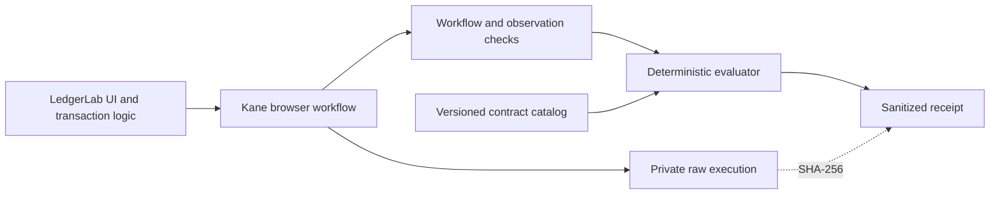

# Phase 1 architecture

- **LedgerLab** uses Next.js App Router and a page-local React ledger. Pure transaction functions operate on integer cents. The fixture modules isolate deliberate defects from the corrected transaction implementation.
- **Contracts** live in `contracts/v1.json`. Each names an objective, required observations, severity, operator and relationship. The evaluator uses explicit operators and rejects incomplete inputs, mismatched provenance and unsafe arithmetic. The idempotency check also requires that the retry used the same ID.
- **Adapter** starts the approved executable with explicit arguments and loopback URL. The Windows npm shim resolves to the installed Kane CommonJS entry point, launched directly by Node to keep objective strings out of CMD interpretation. Stdout and stderr are separate, with a wall-clock watchdog and bounded capture.
- **Verification entry point** checks workflow completion before normalizing browser values. Catalog and objective hashes plus raw stdout and stderr hashes link a receipt to its private sources. The receipt uses a local execution UUID also recorded in the raw record directory. Kane session metadata stays private. Local hashes support comparison and integrity checks against a retained reference.
- **Budget** uses an exclusive filesystem lock and persists each attempt before launch. An interrupted or unknown-cost run blocks further execution. Credits are checked between runs because Kane reports charges after the run.
- **Repair interfaces** describe explicit file and budget authorization, a violation, and a revision comparison. Phase 1 receipts record repair authorization as absent.
